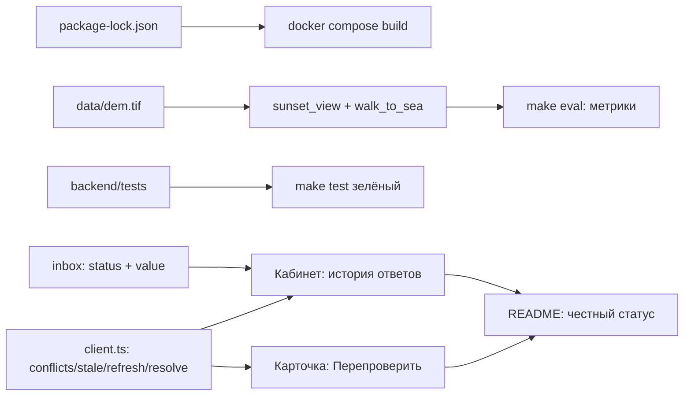

<!-- workai:plan:create id="release-readiness-fixes" -->

## План: Приведение Routely к ТЗ и техническим ограничениям

Устранить два блокера запуска (`package-lock.json` и `data/dem.tif` отсутствуют в репозитории), закрыть разрыв «README/ТЗ заявляют — в коде только API» по кабинету отельера и актуализации, довести `make test` до рабочего состояния и синхронизировать документацию с фактическими числами. Все правки — в корне проблемы: восстановление артефактов и контрактов API, а не обходные fallback-и.

### Проблема

Блокеры обязательного сценария «clone → `docker compose up --build` → :8080»:

- `frontend/Dockerfile` копирует lock-файл, которого нет в репозитории:

```9:10:frontend/Dockerfile
COPY package.json package-lock.json ./
RUN npm ci --no-audit --no-fund
```

`list_files`/`file_search` не находят `package-lock.json` в корне, `git_status` по нему чист — значит на чистом клоне `COPY` падает и сборка `frontend` не доходит до `npm ci`.

- В `data/` лежат `beaches.geojson`, `buildings.gpkg`, `ground_truth.csv`, `hotels.geojson`, `noise_sources.geojson`, `seed.sql`, `_coastal_candidates.json` — **`dem.tif` отсутствует**, хотя README (`668 КБ`), `.gitignore` («dem.tif лежат в репозитории») и HANDOFF утверждают обратное. Код отсутствие файла глотает, поэтому поломка невидима:

```105:108:backend/app/tools/sunset_view.py
def _dem_ready() -> bool:
    try:
        return bool(_DEM_PATH) and _read_dem(_DEM_PATH) is not None
    except Exception:  # noqa: BLE001 - файла может не быть
        return False
```

Следствие: `check_terrain_dem` тихо выключается, `walk_to_sea` теряет штраф за перепад, а `scripts/evaluate.py` печатает «ЗАКАТ: baseline по рельефу не посчитан — нет DEM» — числа из README не воспроизводятся.

Расхождения «заявлено ↔ реализовано»:

- `GET /api/hotelier/inbox` фильтрует `status == "pending"`, а `store.attachQuestions` строит `hotel.questions` только из inbox. После ответа вопрос исчезает из API, блок «Отвечено» в `src/pages/Hotelier.tsx` и `src/pages/Hotel.tsx` в API-режиме всегда пуст, историю ответов отельера посмотреть нельзя.
- Уверенность ответа отельера в UI выдумана: `store.ts` пишет `answer_parsed: { parsed_by: 'LLM', confidence: 0.92 }`, а `Hotel.tsx` рисует `ConfidenceBar value={0.92}` — это прямо противоречит ТЗ «у каждого значения есть источник, уверенность и дата получения».
- `resolve`, `conflicts`, `stale`, `refresh` реализованы на бэкенде, но `src/api/client.ts` их не вызывает вовсе. ТЗ (доп. задачи 3 и 4) и таблица «Статус реализации» в README утверждают, что разбор противоречий «в кабинете» и актуализация работают.
- `make test` запускает `pytest` в образе с контекстом `./backend`, где нет ни одного теста (только `app/`, `Dockerfile`, `Dockerfile.dev`, `pyproject.toml`) — exit code 5.
- `data/ground_truth.csv` содержит 8 строк из 12 отелей (нет `Априори`, `Кандинский`, `Принцесса Элиза`, `Ренессанс`) и пустые `walk_minutes_ref` во всех строках — accuracy считается на 2/3 выборки, ручной MAE пешего пути не считается никогда.

### Связанные файлы

- [frontend/Dockerfile](frontend/Dockerfile) — сборка требует `package-lock.json`; после восстановления lock оставить `npm ci` (воспроизводимость), не менять на `npm install`.
- [package.json](package.json) — источник semver-диапазонов для генерации lock.
- [data/dem.tif](data/dem.tif) — отсутствующий артефакт; восстанавливается через `scripts/fetch_data.py --dem-only`.
- [scripts/fetch_data.py](scripts/fetch_data.py) — `fetch_dem()` (строка 497) качает тайлы SRTM `elevation-tiles-prod` и пишет `dem.tif`; полный прогон перезапишет `buildings.gpkg` и `hotels.geojson`, поэтому нужен флаг `--dem-only`.
- [backend/app/tools/sunset_view.py](backend/app/tools/sunset_view.py), [backend/app/tools/walk_to_sea.py](backend/app/tools/walk_to_sea.py), [backend/app/tools/facade.py](backend/app/tools/facade.py), [backend/app/tools/noise_score.py](backend/app/tools/noise_score.py) — цель юнит-тестов, чистые функции без БД и сети.
- [backend/app/feature_registry.py](backend/app/feature_registry.py) — `coerce`, `SearchRule.clamp/matches`, `resolve_rows`: вся логика достоверности и выбора источника, тестируется без инфраструктуры.
- [backend/app/routers/hotelier.py](backend/app/routers/hotelier.py) — `inbox` (добавить статус и фактическое значение), `resolve` (уже корректен, только не вызывается из UI).
- [backend/app/routers/hotels.py](backend/app/routers/hotels.py) — `/hotels/stale` и `/hotels/{id}/refresh` готовы, нужны только клиент и кнопка.
- [backend/app/seed.py](backend/app/seed.py) — `upsert_feature` и `_comparable`: инвариант «одна строка на источник» и пересчёт `disputed`; новые записи идут только через него.
- [src/api/client.ts](src/api/client.ts) — добавить `getConflicts`, `getStale`, `refreshHotel`, `resolveFeature` по образцу существующих методов (`fetchWithTimeout`, проверка `res.ok`).
- [src/store.ts](src/store.ts) — убрать фейковый `confidence: 0.92`, расширить `attachQuestions`, добавть actions для конфликтов/refresh.
- [src/pages/Hotelier.tsx](src/pages/Hotelier.tsx) — секции «Противоречия» и «Устаревшие данные», реальные значения из API.
- [src/pages/Hotel.tsx](src/pages/Hotel.tsx) — индикатор устаревания и кнопка «Перепроверить».
- [src/api/adapters.ts](src/api/adapters.ts) — прокинуть `stale`/`disputed` в модель характеристики (`HotelFeature` в [src/data/mockHotels.ts](src/data/mockHotels.ts)), сейчас они остаются только текстом в `detail`.
- [backend/Dockerfile.dev](backend/Dockerfile.dev), [backend/pyproject.toml](backend/pyproject.toml) — `pytest` установлен через extras `dev`; нужен `testpaths`/`asyncio_mode`.
- [.env.example](.env.example), [docker-compose.yml](docker-compose.yml), [.dockerignore](.dockerignore), [.gitignore](.gitignore), [nginx.conf](nginx.conf) — соответствие правилам и гигиена.
- [data/ground_truth.csv](data/ground_truth.csv), [scripts/evaluate.py](scripts/evaluate.py) — разметка и метрики.
- [README.md](README.md), [docs/HANDOFF.md](docs/HANDOFF.md) — синхронизация чисел и статусов.

### Поток

Порядок жёсткий: без lock и DEM нельзя проверить ничего остального, а UI-правки бессмысленны, пока контракт inbox не отдаёт историю и реальные значения.



**Шаги**

1. Сгенерировать `package-lock.json` (`npm install --package-lock-only`) и закоммитить; `frontend/Dockerfile` не менять.
2. Восстановить `data/dem.tif` через `scripts/fetch_data.py --dem-only` (не полный `make data`, чтобы не перетереть `buildings.gpkg` и `hotels.geojson`) и закоммитить файл.
3. Создать `backend/tests/` с тестами чистых функций: `coerce`/`clamp`/`matches`/`resolve_rows`, `building_wall_azimuths` на прямоугольнике, `_keyword_intent`/`_clamp_intent`, `_comparable`; тесты не должны требовать PostGIS, DEM и сети.
4. Удалить корневые `test_deepseek.py`, `test_llm.py`, `test_pipeline.py` (в контекст сборки `backend` они не попадают) и задать `[tool.pytest.ini_options]` с `testpaths = ["tests"]`.
5. Расширить `GET /api/hotelier/inbox`: параметр `status` (`pending`/`answered`/`all`), поля `answer_raw`, `answer_parsed`, `answered_at` и фактическое значение из `hotel_features` (`source="hotelier"`: value, confidence, computed_at).
6. Заменить выдуманный `confidence: 0.92` в `store.ts`, `Hotelier.tsx`, `Hotel.tsx` реальными значениями из ответа API; после отправки ответа перезапрашивать inbox, а не править состояние локально.
7. Добавить в `src/api/client.ts` методы `getConflicts`, `getStale`, `refreshHotel`, `resolveFeature` с теми же правилами обработки ошибок, что у существующих.
8. Собрать в `Hotelier.tsx` блок «Противоречия источников» (`/api/conflicts` → варианты → подтвердить/исправить → `/resolve`) и блок «Устаревшие данные» (`/api/hotels/stale` → «Перепроверить»).
9. В `Hotel.tsx` показывать признак устаревания характеристики и кнопку «Перепроверить» → `POST /api/hotels/{id}/refresh` (поле `stale` уже приходит в `/api/hotels`, нужно довести до модели UI через `adapters.ts`).
10. Дополнить `.env.example`, `environment` backend в `docker-compose.yml` и таблицу переменных в README: `NOISE_PATH`, `BEACHES_PATH`, `HOTELS_PATH`, `LLM_TIMEOUT_S`, `ROUTELY_API`, `GROUND_TRUTH`, `EVAL_REPORT` (сейчас пути живут на дефолтах `config.py`, которые в контейнере случайно совпадают с `/data`).
11. Гигиена: добавить `.env` в `.dockerignore`, удалить неиспользуемый корневой `nginx.conf` (`listen 80`, конфликтует с `frontend/nginx.conf`), удалить `data/_coastal_candidates.json`, схлопнуть продублированные блоки `.gitignore`.
12. Дозаполнить `data/ground_truth.csv` до 12 строк (включая `Априори`, `Кандинский`, `Принцесса Элиза`, `Ренессанс`), затем прогнать `make eval` и перенести фактически полученные числа в README вместо текущих.
13. Обновить README и `docs/HANDOFF.md`: реальный `git clone` URL, ссылка на видео-скринкаст вместо TODO, файл `dem.tif` в таблице данных, убрать устаревшее «закат виден у 1 из 12» из раздела 13; отдельным коммитом закоммитить правку `scripts/evaluate.py`.

**Проверка**

1. `docker compose down -v && docker compose up --build` на свежем клоне: сборка проходит, `curl http://localhost:8080/health` → `{"status":"ok","service":"routely-ostrovok"}`, UI открывается на :8080.
2. `make test` → `pytest` возвращает 0, тестов больше нуля (проверка на exit code 5).
3. `make eval` → блок «ЗАКАТ: НАШ РАСЧЁТ ПРОТИВ ПРОВЕРКИ ПО ОДНОМУ РЕЛЬЕФУ» заполнен (12 отелей), в `data/eval_report.json` поля `sunset_vs_terrain_baseline` и `walk_vs_baseline` не `null`, `manual_metrics` непустой.
4. `curl localhost:8080/api/hotelier/inbox` → у answered-вопроса есть `answer_raw`, `answered_at` и значение из `hotel_features`; после ответа вопрос не исчезает из выдачи.
5. В кабинете: ответить → в блоке «Отвечено» confidence совпадает с БД (не 0.92); в карточке отеля тот же confidence.
6. `curl -X POST localhost:8080/api/hotels/19/refresh` → `stale_features` в ответе; на карточке появилась кнопка «Перепроверить» и после клика характеристики обновились.
7. `curl localhost:8080/api/conflicts` → после ответа отельера, расходящегося с гео, конфликт виден; `resolve` переводит `still_disputed` в `false`.
8. `grep -c '^\.env$' .dockerignore` → 1; `docker compose build frontend` не отправляет `.env` в контекст.
9. Ручной чек README по шаблону: описание, быстрый старт, переменные, сидирование, маршруты, видео — все на месте, TODO отсутствует, `git clone <URL>` заменён на реальный адрес репозитория организации.

**Решения**

- Lock-файл генерируется и коммитится, а не заменяется на `npm install`: правило требует фиксации версий зависимостей, а `npm install` в образе делает сборку невоспроизводимой.
- DEM кладётся в репозиторий (668 КБ при лимите «без больших артефактов» — это демо-данные, которых требует ТЗ), а не подменяется синтетическим рельефом: «плоский DEM» сделал бы `sunset_view` и `walk_to_sea` фиктивными.
- Тесты пишутся на чистые функции, а не интеграционные с БД: `test`-сервис не поднимает Postgres, иначе `make test` станет флейки и его перестанут запускать.
- Контракт inbox расширяется аддитивно (`status` по умолчанию `all`, новые поля), `attachQuestions` в сторе продолжит работать; отдельный эндпоинт истории ответов не вводится — данные уже есть в `hotelier_questions` и `hotel_features`.
- Запись ответа и resolve остаются на существующем `upsert_feature(source="hotelier")`: инвариант «одна строка на источник» и пересчёт `disputed` уже реализованы, дублировать логику в роутере нельзя.
- `volumes: ./backend:/app` в compose оставляем как есть: это осознанный dev-компромисс, но он маскирует ошибки образа — фиксируем в README, что проверка идёт через `docker compose up --build`, а не через локальный uvicorn.
- Неиспользуемый фронтендом SSE `/api/agent/{thread_id}/stream` не удаляем (он работает и описан в API-таблице), но в README отмечаем, что UI получает шаги через `agent_log` в ответе `/search`.
- Вне объёма: перенос репозитория в организацию, тег `submission`, значения разметки по панорамам и видео — это ручные действия человека, код их не закрывает.

**Риски**

- `npm install --package-lock-only` требует сети, а версии зафиксируются по текущим semver-диапазонам — сборка может отличаться от того образа, что сейчас работает локально; после генерации обязательна полная пересборка, а не инкрементальная.
- `--dem-only` может не покрыть регион, если bbox в `fetch_data.py` менялся: проверить, что `dem_elevation()` возвращает высоту для координат всех 12 отелей (иначе `sunset_view` снова деградирует, но уже молча).
- Расширение inbox меняет форму ответа: если `Hotelier.tsx` начнёт получать answered-вопросы без соответствующей фильтрации, они попадут в «Ожидают ответа» — фильтрация по `q.status` уже есть, её нельзя убирать.
- Правки `client.ts` и `store.ts` затрагивают offline-режим: при недоступном бэкенде UI должен остаться работоспособным на демо-наборе, как сейчас, а новые методы — возвращать пустые значения, а не бросать исключения.
- После пересчёта `make eval` числа в README почти наверняка изменятся: обновлять их нужно по факту прогона, а не подгонять под текущую таблицу.